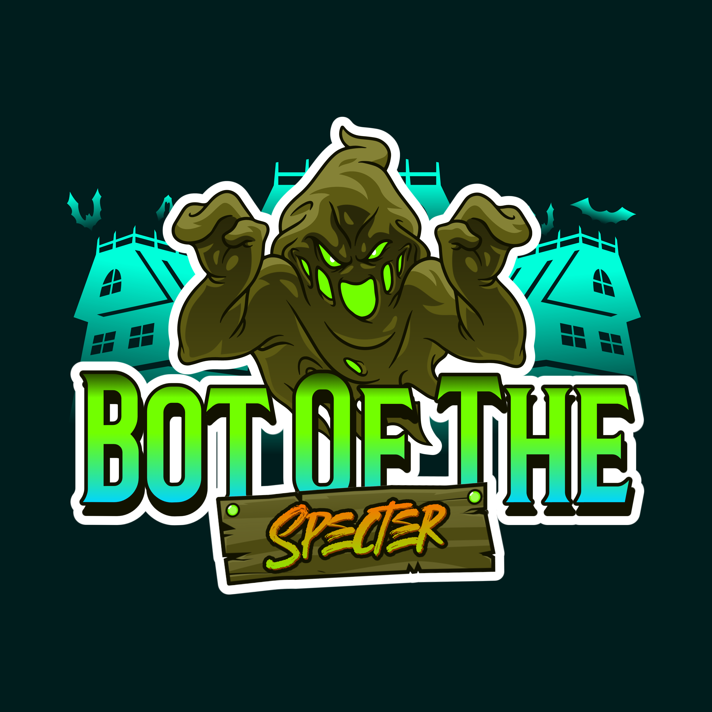

<p align="center">
  
</p>

<h1 align="center">BotOfTheSpecter Desktop</h1>

<p align="center">
  The desktop control room for your stream — bridge OBS Studio to BotOfTheSpecter
  and run your whole channel from a single window.
</p>

---

## What is it?

BotOfTheSpecter Desktop is a cross-platform app (Windows, macOS, Linux) that connects
**OBS Studio** and your **BotOfTheSpecter** account in real time. It mirrors what's happening
on your stream — scenes, audio, recording, chat, redemptions, follows/subs/bits/raids — into
one dashboard, and lets you act on it: switch scenes, toggle sources, fire commands, and build
automations that react to events as they happen.

Think of it as the bridge between OBS and your bot, plus a live control panel for the things
you'd otherwise juggle across OBS, Twitch, and the bot dashboard.

## Features

### Live control & monitoring
- **Dashboard** — bot status, Twitch live state (viewers, game, title) and OBS/relay health at a
  glance, with a rolling activity feed.
- **OBS Control** — switch scenes, toggle source visibility and filters, manage the audio mixer
  (mute, volume, live peak meters), and start/stop streaming, recording, the replay buffer and the
  virtual camera. Accurate LIVE timecode plus bitrate, CPU, FPS and dropped-frame stats, and a raw
  event log.
- **Chat & Mod** — live Twitch chat with moderation events (bans, timeouts, deletes, clears).
- **Cameras** — stream the Specter Camera phone app to this PC over your local network (no internet
  round trip). Pair a phone by scanning a QR code, then add each camera to OBS as a Browser Source at
  `http://<this PC>:47830/view/<camera>` (or one click with **Add to OBS**). Runs a bundled
  [MediaMTX](https://github.com/bluenviron/mediamtx) server that is off until you turn it on. Phones
  publish RTMP (port 1935) or SRT (8890/udp); send Opus or G711 audio to hear it in OBS.
- **Channel Points** — view your Twitch reward redemptions and wire them into actions.

### Engagement & automation
- **Commands** — browse built-in, custom and viewer commands; enable/disable built-ins and set
  their permission level.
- **Automations & Actions** — a visual rules engine. Triggers (chat message/command, follow, sub,
  bits, raid, channel-point redemption, stream go-live/end, OBS scene switch, OBS stream start/stop,
  manual, public webhook) fire reusable **Actions**: call a webpage, set a variable, run a command,
  play a sound, speak via TTS, toggle another automation, send a webhook, or drive Twitch directly
  (toggle a reward, run ads, create a marker, start/stop polls and predictions, slow mode, clip).
  Organize them in folders, gate them with checks, and serialize them with named queues.
- **Variables** — real-time event data for your commands and checks: last follower / cheer / sub /
  raid / redemption / donation, plus session and lifetime counters and live stream status.

### System
- **Logs** — a filterable, searchable event stream across OBS, Twitch, the relay and the bot.
- **Settings** — API key, light/dark/system theme, density, and OBS stream-timer calibration. Your
  key is validated before connecting.

> **On the roadmap:** the Alerts, Soundboard, Song Requests, Timers and Giveaways/Polls/Predictions
> screens are already in the app and waiting on their backend services.

## How it works

1. **Add your API key** — paste your BotOfTheSpecter API key in Settings; it's validated against the
   BotOfTheSpecter API and then connects to the relay.
2. **Connect OBS** — enter your OBS WebSocket host, port and password on the OBS Control screen (or
   let it auto-connect on launch).
3. **Go live** — the app forwards OBS events to the bot and surfaces chat, redemptions and stream
   status in real time.
4. **Automate** — build automations that react to triggers with reusable actions.

## Requirements

- **OBS Studio 28 or newer** with **obs-websocket 5.x** enabled (OBS → *Tools → WebSocket Server
  Settings*).
- A **BotOfTheSpecter account** and **API key** (from your BotOfTheSpecter dashboard).
- **Windows, macOS, or Linux.**

---

## Install

### Download a build

Grab the latest release for your platform from the
**[Releases page](https://github.com/YourStreamingTools/BotOfTheSpecter-Connector-App/releases)**.
On Windows that is a **setup** installer (`*-setup.exe`) and a **portable** exe
(`*-portable.exe`) you can run without installing. No Python or other runtime required.

### Run from source

Requires **Node.js 18 or newer**.

```bash
git clone https://github.com/YourStreamingTools/BotOfTheSpecter-Connector-App.git
cd BotOfTheSpecter-Connector-App
npm install
npm run fetch:mediamtx   # one-time: download the local camera server for your platform
npm run dev        # launch with hot reload
```

Or use the launcher for your OS: double-click **`run.bat`** on Windows, or run **`./run.sh`** on
macOS/Linux. It checks your Node version, installs dependencies and the camera server on first
run, and starts the app.

### Build release packages

```bash
build.bat               # Windows
./build.sh              # macOS / Linux
```

This runs the typecheck and tests, then builds the Windows and Linux packages into `dist/`:

- Windows: `*-setup.exe` and `*-portable.exe`
- Linux: `*-linux-x64.tar.gz`, plus an `*.AppImage` when built on Linux

Add `--win` or `--linux` to build just one, or `--skip-checks` to skip the typecheck and tests.
Building the Windows packages on Linux needs [Wine](https://www.winehq.org); without it, that
step is skipped. Windows and macOS need nothing extra.

The macOS app is built separately, on a Mac: `./build.sh --mac` makes signed and notarized DMGs
(x64 and arm64) when a Developer ID certificate and notarization credentials are set up (see the
comments at the top of `build.sh`). `CSC_IDENTITY_AUTO_DISCOVERY=false ./build.sh --mac` makes an
unsigned build for local testing.

## Development

```bash
npm run dev        # launch the app with hot reload
npm test           # run unit + component tests (Vitest)
npm run typecheck  # strict TypeScript check (renderer + node projects)
npm run build      # production build → out/
npm run fetch:mediamtx -- --all   # MediaMTX for every platform → resources/mediamtx/ (the dist:* scripts do this)
```

The local camera end-to-end test runs only when MediaMTX and ffmpeg are available:
`SPECTER_MEDIAMTX_PATH=resources/mediamtx/<platform>-<arch>/mediamtx npx vitest run src/main/camera`.

### Project layout

- `src/main` — Electron main process: config, window, and the OBS / relay / Twitch / commands /
  automation services.
- `src/preload` — the typed `window.api` contextBridge.
- `src/renderer` — React UI (shell, screens, design tokens).
- `src/shared` — shared constants and the IPC contract.
- `legacy/` — the original PyQt6 connector, preserved for reference.
- `docs/` — project site ([app.botofthespecter.com](https://app.botofthespecter.com)) and version history.

### Configuration

Settings persist to `<userData>/config.json`. On first launch the app imports an existing PyQt
config from `…/BotOfTheSpecter/OBSConnector/config.json` if present. Secrets such as your API key
are redacted from the logs and event views, and OAuth tokens never leave the main process.

> **v2.0** is a full rewrite of the former PyQt6 connector (Electron + React + TypeScript). The
> previous Python app lives under [`legacy/`](./legacy).
